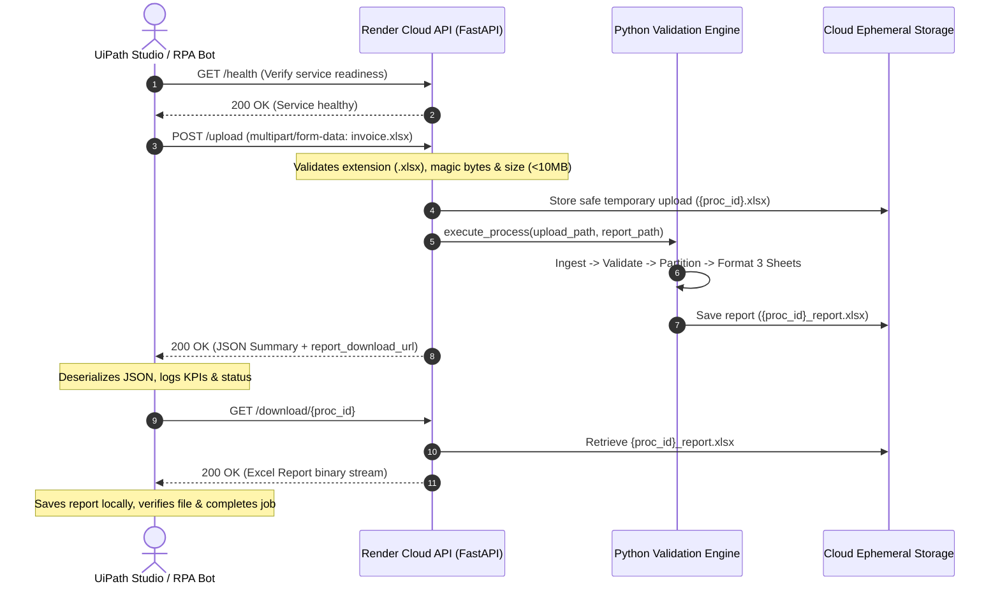
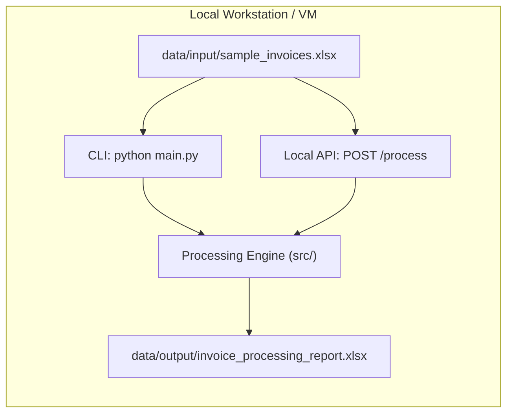
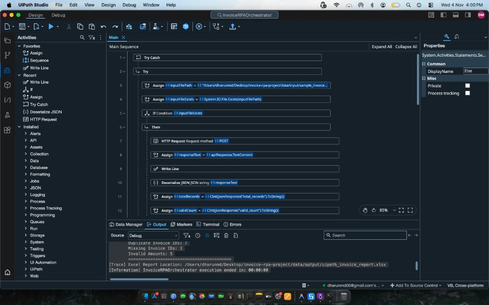
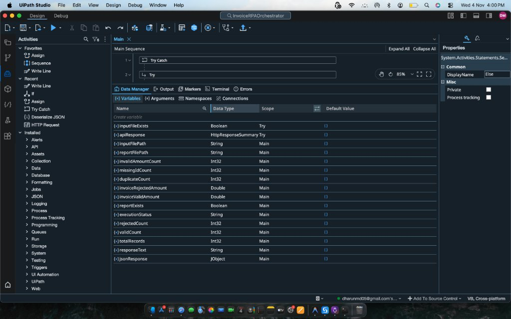
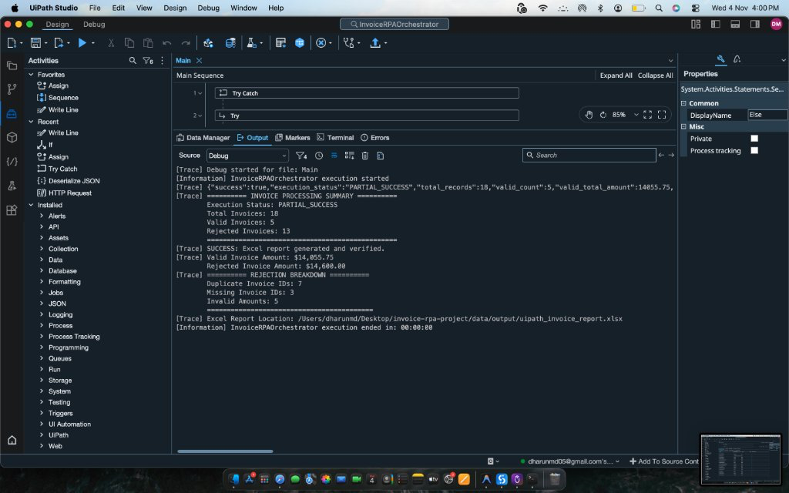

# InvoiceProcessingAutomationBot 🤖📊

[](https://www.python.org/)
[](tests/)
[](render.yaml)
[](#-rpa-orchestrator-integration-guide)
[](https://peps.python.org/pep-0008/)
[%20%7C%20macOS%20%7C%20Linux%20%7C%20Windows-lightgrey.svg)](README.md)
[](LICENSE)

An enterprise-grade **Robotic Process Automation (RPA)** Python engine and **FastAPI Cloud Web Service** designed to ingest, validate, audit, and segregate batch Excel invoices with zero mutation to source files.

Supports dual operational architectures:
1. **Cloud REST API (Render / Containerized)**: Upload Excel workbooks via `multipart/form-data` and download formatted 3-sheet Excel audit reports from remote orchestrators.
2. **Local RPA Execution**: Direct CLI execution, in-memory Python Scope calls, or loopback REST calls for desktop automation.

---

## 📑 Table of Contents

- [🌟 Key Highlights](#-key-highlights)
- [💻 Technology Stack](#-technology-stack)
- [🏗️ System Architecture](#️-system-architecture)
  - [Cloud Workflow (Render & Remote UiPath)](#cloud-workflow-render--remote-uipath)
  - [Local Workflow (CLI & Local Path API)](#local-workflow-cli--local-path-api)
- [📋 Validation Rules Engine](#-validation-rules-engine)
- [📊 Output Report Specifications](#-output-report-specifications)
- [🌐 REST API Endpoint Reference](#-rest-api-endpoint-reference)
  - [1. GET /health](#1-get-health)
  - [2. POST /upload (Cloud Multipart Processing)](#2-post-upload-cloud-multipart-processing)
  - [3. GET /download/{processing_id} (Cloud Report Download)](#3-get-downloadprocessing_id-cloud-report-download)
  - [4. POST /process (Local Path Compatibility)](#4-post-process-local-path-compatibility)
- [☁️ Render Cloud Deployment Guide](#️-render-cloud-deployment-guide)
- [🤖 UiPath Studio Cloud Integration Guide](#-uipath-studio-cloud-integration-guide)
- [📸 Project Screenshots](#-project-screenshots)
- [📁 Project Structure](#-project-structure)
- [⚙️ Prerequisites & Local Installation](#️-prerequisites--local-installation)
- [🚀 Local Execution Modes](#-local-execution-modes)
- [🧪 Automated Test Suite](#-automated-test-suite)
- [📜 Logging & Audit Trail](#-logging--audit-trail)
- [🛡️ Security & Cloud Reliability](#️-security--cloud-reliability)
- [📄 License](#-license)

---

## 🌟 Key Highlights

1. **Cloud-Ready File Upload & Download**: Eliminates local file-path dependencies through secure `multipart/form-data` file streaming and unique processing ID tokens.
2. **Strictly Read-Only Ingestion**: Reads Excel workbooks without modifying source inputs, maintaining cryptographic hash verification for total data integrity.
3. **Aggressive Duplicate Prevention**: Automatically flags and rejects **every single occurrence** of duplicate Invoice IDs across the batch (`keep=False`), preventing duplicate or fraudulent ERP disbursements.
4. **Multi-Reason Defect Capture**: Aggregates all applicable failure reasons per record (e.g. invalid balance + missing invoice ID) rather than halting on first error.
5. **Executive 3-Sheet Excel Workbook**:
   - **`Audit Summary`**: Executive KPI cards, execution duration, and incident frequency breakdown.
   - **`Valid Invoices`**: Clean ERP-ready invoices styled with emerald headers and currency formatting.
   - **`Rejected Invoices`**: Defective invoices styled in crimson with highlighted rejection reasons.
6. **Hardened Cloud Security**:
   - 10 MB upload limits to prevent resource exhaustion (HTTP 413).
   - Strict ZIP container magic byte verification (`b"PK\x03\x04"`).
   - Regex-enforced processing ID validation to block path traversal attacks.
   - Automated background cleanup of ephemeral uploads and reports.

---

## 💻 Technology Stack

| Domain | Technology | Version | Purpose |
| :--- | :--- | :--- | :--- |
| **Backend Framework** | [FastAPI](https://fastapi.tiangolo.com/) | `>= 0.115.0` | High-performance asynchronous REST API |
| **ASGI Web Server** | [Uvicorn](https://www.uvicorn.org/) | `>= 0.30.0` | Production ASGI web server |
| **Form & File Handling**| [python-multipart](https://github.com/Kludex/python-multipart) | `>= 0.0.9` | Streaming multipart file uploads |
| **Data Processing** | [Pandas](https://pandas.pydata.org/) | `>= 2.2.0` | Vectorized validation & dataset segregation |
| **Spreadsheet Engine** | [OpenPyXL](https://openpyxl.readthedocs.io/) | `>= 3.1.2` | Read-only Excel ingestion & report styling |
| **Data Validation** | [Pydantic v2](https://docs.pydantic.dev/) | `>= 2.9.0` | Request & response schema contracts |
| **Automated Testing** | [Pytest](https://docs.pytest.org/) & [HTTPX](https://www.python-httpx.org/) | `>= 8.0.0` | 33 comprehensive integration and unit tests |
| **RPA Orchestrator** | [UiPath Studio](https://www.uipath.com/) | `Cross-Platform` | Automated robotic trigger & reporting pipeline |
| **Cloud Hosting** | [Render](https://render.com/) | Free Web Service | Automated Git-backed continuous cloud deployment |

---

## 🏗️ System Architecture

### Cloud Workflow (Render & Remote UiPath)



### Local Workflow (CLI & Local Path API)



---

## 📋 Validation Rules Engine

| Rule | Condition / Trigger | Rejection Reason | Handling Behavior |
| :--- | :--- | :--- | :--- |
| **Missing ID** | Null, `NaN`, `""`, whitespace | `"Missing or empty Invoice ID"` | Flagged; excluded from duplicate mask to avoid false matches. |
| **Duplicate ID**| Duplicate anywhere in batch (`keep=False`) | `"Duplicate Invoice ID (all occurrences rejected)"` | **Every** instance (original & copies) is rejected for compliance review. |
| **Invalid Amount** | Non-numeric, negative, or `$0.00` | `"Amount must be a positive numeric value (> 0)"` | Parsed safely; values `<= 0` or non-numeric strings are rejected. |
| **Multi-Error**| Violates 2 or more business rules | *Concatenated with semicolon* | e.g. `"Duplicate Invoice ID (...); Amount must be a positive..."` |

---

## 📊 Output Report Specifications

The generated Excel workbook contains three professionally formatted worksheets:

```text
invoice_audit_report.xlsx
├── 📄 [Audit Summary]     -> Executive dashboard, KPI stat cards, and error frequency table
├── 📄 [Valid Invoices]    -> Clean, approved records styled in emerald green (ERP-ready)
└── 📄 [Rejected Invoices] -> Flagged records styled in crimson with itemized Rejection Reasons
```

---

## 🌐 REST API Endpoint Reference

### 1. `GET /health`
Returns service readiness and operational status. Ideal for RPA bots before dispatching batches.

- **URL**: `/health`
- **Method**: `GET`
- **Response (200 OK)**:
  ```json
  {
    "status": "healthy",
    "service": "InvoiceProcessingAutomationBot",
    "version": "2.0.0"
  }
  ```

---

### 2. `POST /upload` (Cloud Multipart Processing)
Upload an invoice workbook via `multipart/form-data`. The file is securely ingested, validated, and processed into a multi-sheet audit report.

- **URL**: `/upload`
- **Method**: `POST`
- **Content-Type**: `multipart/form-data`
- **Parameters**: `file` (Binary Excel file, `.xlsx` only, max 10 MB)

#### Example Request (`curl`):
```bash
curl -X POST "https://your-app.onrender.com/upload" \
     -F "file=@data/input/sample_invoices.xlsx"
```

#### Successful Response (200 OK):
```json
{
  "success": true,
  "processing_id": "a1b2c3d4e5f6789012345678abcdef01",
  "processing_status": "PARTIAL_SUCCESS",
  "total_invoices": 18,
  "valid_invoice_count": 5,
  "rejected_invoice_count": 13,
  "valid_invoice_amount": 14055.75,
  "rejected_invoice_amount": 14600.0,
  "duplicate_count": 7,
  "missing_id_count": 3,
  "invalid_amount_count": 5,
  "report_download_url": "/download/a1b2c3d4e5f6789012345678abcdef01",
  "duration_seconds": 0.024,
  "start_time": "2026-11-04 16:30:00 UTC",
  "end_time": "2026-11-04 16:30:00 UTC"
}
```

#### Error Responses:
- **`400 Bad Request`**: Uploaded file is empty, missing required columns, or not a valid `.xlsx` zip container.
- **`413 Content Too Large`**: File exceeds the 10 MB upload threshold.
- **`422 Unprocessable Entity`**: Request omitted the `file` field.

---

### 3. `GET /download/{processing_id}` (Cloud Report Download)
Securely downloads the generated Excel audit report using the unique `processing_id` returned by `/upload`.

- **URL**: `/download/{processing_id}`
- **Method**: `GET`
- **Content-Type**: `application/vnd.openxmlformats-officedocument.spreadsheetml.sheet`

#### Example Request (`curl`):
```bash
curl -O -J "https://your-app.onrender.com/download/a1b2c3d4e5f6789012345678abcdef01"
```

---

### 4. `POST /process` (Local Path Compatibility)
Maintained for backward compatibility with local desktop automation scripts.

- **URL**: `/process`
- **Method**: `POST`
- **Content-Type**: `application/json`
- **Request Body**:
  ```json
  {
    "input_path": "data/input/sample_invoices.xlsx",
    "output_path": "data/output/invoice_processing_report.xlsx"
  }
  ```

---

## ☁️ Render Cloud Deployment Guide

The application is natively pre-configured for **Render** via [`render.yaml`](render.yaml).

### Step 1: Push Repository to GitHub
Ensure all changes are committed and pushed to your GitHub repository:
```bash
git push origin main
```

### Step 2: Create a New Web Service on Render
1. Sign in to your [Render Dashboard](https://dashboard.render.com/).
2. Click **New +** -> **Web Service**.
3. Select **Build and deploy from a Git repository** and connect your repository:
   ```text
   https://github.com/Dharunmd/InvoiceProcessingAutomationBot
   ```

### Step 3: Configure Service Parameters
Render will automatically detect settings from [`render.yaml`](render.yaml). If setting up manually:
- **Name**: `invoice-processing-automation-bot`
- **Environment**: `Python 3`
- **Region**: Oregon (US West) or nearest region
- **Branch**: `main`
- **Build Command**: `pip install -r requirements.txt`
- **Start Command**: `uvicorn api:app --host 0.0.0.0 --port $PORT`
- **Instance Type**: `Free`

### Step 4: Health Check & Environment Settings
- Under **Advanced**, verify:
  - **Health Check Path**: `/health`
  - **Auto-Deploy**: `Yes`

### Step 5: Deploy & Verify
Click **Create Web Service**. Once Render confirms deployment:
1. Copy your assigned public URL (e.g., `https://invoice-processing-automation-bot.onrender.com`).
2. Test health endpoint:
   ```bash
   curl https://your-service.onrender.com/health
   ```
3. Test cloud upload with sample data:
   ```bash
   curl -X POST https://your-service.onrender.com/upload \
        -F "file=@data/input/sample_invoices.xlsx"
   ```

> [!NOTE]
> **Free-Tier Characteristics**:
> - **Spin Down (Cold Starts)**: Free instances sleep after 15 minutes of inactivity. The first request after a sleep period may take ~45–60 seconds to spin up.
> - **Ephemeral Storage**: Uploaded files and generated reports are stored on the ephemeral filesystem. Reports are intended for immediate download by UiPath and are cleaned up automatically after 1 hour.

---

## 🤖 UiPath Studio Cloud Integration Guide

This guide details configuring UiPath Studio to process invoices against your deployed cloud instance.

### Variable Setup in UiPath Data Manager

| Variable Name | Type | Scope | Description / Sample Value |
| :--- | :--- | :--- | :--- |
| `apiBaseUrl` | `String` | `Main` | `"https://your-service.onrender.com"` (or `"http://127.0.0.1:8000"`) |
| `inputFilePath` | `String` | `Main` | `"/Users/.../Desktop/invoices.xlsx"` (local invoice file to upload) |
| `reportSavePath`| `String` | `Main` | `"/Users/.../Desktop/invoice_report.xlsx"` (local destination) |
| `uploadResponse`| `String` | `Main` | Output string variable from `/upload` HTTP activity |
| `statusCode` | `Int32` | `Main` | HTTP status code variable |
| `jsonObj` | `JObject`| `Main` | Deserialized JSON response |
| `processingId` | `String` | `Main` | Extracted `jsonObj("processing_id").ToString` |
| `downloadUrl` | `String` | `Main` | Extracted `jsonObj("report_download_url").ToString` |

### UiPath Activity Sequence

```text
Sequence: Process Invoices via Cloud API
├── Assign: apiBaseUrl = "https://your-app.onrender.com"
├── Assign: inputFilePath = "C:\Invoices\Batch_Nov.xlsx"
├── Assign: reportSavePath = "C:\Reports\Audit_Report.xlsx"
│
├── Try Catch (Error Boundary)
│   ├── Try
│   │   ├── HTTP Request (Upload Invoice File)
│   │   │   ├── Endpoint: apiBaseUrl + "/upload"
│   │   │   ├── Method: POST
│   │   │   ├── Attachments: Add entry with Name="file", FilePath=inputFilePath
│   │   │   ├── Result: uploadResponse
│   │   │   └── StatusCode: statusCode
│   │   │
│   │   ├── If: statusCode <> 200
│   │   │   └── Throw: New BusinessRuleException("API Error: " + uploadResponse)
│   │   │
│   │   ├── Deserialize JSON
│   │   │   ├── JsonString: uploadResponse
│   │   │   └── JsonObject: jsonObj
│   │   │
│   │   ├── Assign: processingId = jsonObj("processing_id").ToString
│   │   ├── Assign: downloadUrl = jsonObj("report_download_url").ToString
│   │   │
│   │   ├── Log Message: "Processed " + jsonObj("total_invoices").ToString + " invoices. Valid: " + jsonObj("valid_invoice_count").ToString
│   │   │
│   │   ├── HTTP Request (Download Audit Report)
│   │   │   ├── Endpoint: apiBaseUrl + downloadUrl
│   │   │   ├── Method: GET
│   │   │   ├── ResourcePath: reportSavePath
│   │   │   └── StatusCode: statusCode
│   │   │
│   │   ├── Path Exists: Verify reportSavePath exists
│   │   └── Log Message: "Audit Report successfully downloaded to " + reportSavePath
│   │
│   └── Catch Exception (System.Exception)
│       └── Log Message: "Failed to process invoices: " + exception.Message
```

---

## 📸 Project Screenshots

Visual documentation illustrating the end-to-end integration between UiPath Studio, the FastAPI backend, and the generated audit deliverables.

### 1. UiPath RPA Workflow Sequence
The primary sequence in UiPath Studio demonstrating cross-platform robotic orchestration on macOS: checking file presence, sending an HTTP POST request to the local FastAPI daemon, receiving the JSON response, and deserializing output metrics.



---

### 2. UiPath Variables & Data Manager
Configuration of automation variables within UiPath Studio Data Manager, defining types (`HttpResponseSummary`, `JObject`, `Int32`, `Double`, `String`) and scopes across the execution pipeline.



---

### 3. Successful Execution & Output Trace
Real-time UiPath Studio Output console trace verifying automated batch completion: 18 invoices processed (5 approved, 13 rejected with categorized reasons), dollar totals calculated, and target report path verified.



---

### 4. Generated Excel Audit Report
Multi-sheet executive Excel workbook featuring the executive KPI dashboard, emerald-themed ERP-ready valid invoices, and crimson-annotated rejection logs.

> ⚠️ **Screenshot Placeholder**: `excel-audit-report.png` is pending capture.
>
> *(To complete this visual, take a screenshot of `data/output/sample_output_report.xlsx` and save it to `assets/screenshots/excel-audit-report.png`)*

```text
+----------------------------------------------------------------------------------------------------+
|                                  INVOICE AUDIT PROCESSING SUMMARY                                  |
|                             Generated: 2026-11-03 13:11:42 UTC | System: RPA-Bot                   |
+----------------------------------------------------------------------------------------------------+
|  TOTAL PROCESSED: 18   |   VALID: 5 ($14,055.75)   |   REJECTED: 13 ($14,600.00)   | STATUS: PASS   |
+----------------------------------------------------------------------------------------------------+
```

---

### 5. FastAPI Interactive Documentation (Swagger UI)
Interactive API playground available at `http://127.0.0.1:8000/docs`, documenting request schemas, parameters, and status response contracts for the `/upload`, `/download/{id}`, `/health`, and `/process` endpoints.

> ⚠️ **Screenshot Placeholder**: `fastapi-docs.png` is pending capture.
>
> *(To complete this visual, run `python api.py`, open `http://127.0.0.1:8000/docs` in your browser, and save the screenshot to `assets/screenshots/fastapi-docs.png`)*

---

### 6. API Error Handling & Validation Boundary
Demonstration of HTTP 404 (file not found) and HTTP 400 (corrupt workbook or schema mismatch) error responses caught and structured gracefully by the API boundary.

> ⚠️ **Screenshot Placeholder**: `error-handling.png` is pending capture.
>
> *(To complete this visual, trigger a 404/400 test or capture Swagger UI error response, and save it to `assets/screenshots/error-handling.png`)*

---

## 📁 Project Structure

```text
invoice-rpa-project/
├── .gitignore                             # Exclusion rules (caches, .venv, uploads, lockfiles)
├── LICENSE                                # MIT open-source license
├── README.md                              # Complete architecture, setup, and usage guide
├── render.yaml                            # Render Infrastructure-as-Code Web Service blueprint
├── api.py                                 # Cloud & local FastAPI server (/upload, /download, /process)
├── main.py                                # Dual CLI and UiPath Python Scope entrypoint
├── requirements.txt                       # Production dependencies (FastAPI, Pandas, OpenPyXL, etc.)
│
├── assets/
│   └── screenshots/                       # Visual assets and documentation screenshots
│       ├── .gitkeep
│       ├── uipath-workflow.png            # UiPath Studio automation sequence
│       ├── uipath-variables.png           # UiPath Data Manager & variable scopes
│       └── successful-execution.png       # Real-time execution output trace
│
├── data/
│   ├── input/
│   │   └── sample_invoices.xlsx           # Sample input workbook with realistic test records
│   └── output/
│       ├── .gitkeep                       # Preserves output folder in version control
│       └── sample_output_report.xlsx      # Pre-generated sample multi-sheet Excel report
│
├── logs/
│   ├── .gitkeep                           # Preserves log directory in version control
│   └── processing.log                     # Application execution and rotating audit logs
│
├── scripts/
│   └── generate_sample_data.py            # Utility to generate fresh synthetic test batches
│
├── src/
│   ├── __init__.py                        # Package marker
│   ├── config.py                          # Schema constants, file paths, and status codes
│   ├── exceptions.py                      # Custom exception taxonomy (Fail-Fast design)
│   ├── logger.py                          # Dual-destination logging (console + rotating file)
│   ├── reader.py                          # Read-only Excel ingestion with schema verification
│   ├── validator.py                       # Multi-rule validation engine with reason capture
│   ├── processor.py                       # Data segregation and audit metrics aggregator
│   └── reporter.py                        # OpenPyXL multi-sheet report generator and styler
│
└── tests/
    ├── __init__.py                        # Package marker
    ├── conftest.py                        # Pytest fixtures and mock dataset factories
    ├── test_cloud_api.py                  # Cloud /upload, /download, limits & validation tests
    ├── test_api.py                        # Legacy /process & /health REST endpoint tests
    ├── test_reader.py                     # Ingestion tests (corrupt, empty, missing, schema)
    ├── test_validator.py                  # Rule tests (missing IDs, duplicate all, invalid amounts)
    └── test_processor.py                  # Integration and Excel report generation tests
```

---

## ⚙️ Prerequisites & Local Installation

### Requirements
- **Python**: `3.10`, `3.11`, `3.12`, or `3.13`
- **Operating System**: macOS (Apple Silicon or Intel), Linux, or Windows 10/11 / Windows Server

### Step 1: Clone or Navigate to the Workspace
```bash
git clone https://github.com/Dharunmd/InvoiceProcessingAutomationBot.git
cd InvoiceProcessingAutomationBot
```

### Step 2: Set Up Virtual Environment
- **macOS / Linux**:
  ```bash
  python3 -m venv .venv
  source .venv/bin/activate
  ```
- **Windows (Command Prompt / PowerShell)**:
  ```powershell
  python -m venv .venv
  .venv\Scripts\Activate.ps1
  ```

### Step 3: Install Dependencies
```bash
pip install --upgrade pip
pip install -r requirements.txt
```

---

## 🚀 Local Execution Modes

### 1. Run as Cloud / Local Web API Server
```bash
python api.py
```
Or directly with Uvicorn:
```bash
uvicorn api:app --host 127.0.0.1 --port 8000
```
- Interactive Swagger UI: [http://127.0.0.1:8000/docs](http://127.0.0.1:8000/docs)
- Interactive ReDoc: [http://127.0.0.1:8000/redoc](http://127.0.0.1:8000/redoc)

### 2. Standalone CLI Execution
```bash
python main.py
```
Or with custom flags:
```bash
python main.py -i "data/input/sample_invoices.xlsx" -o "data/output/report.xlsx"
```

### 3. Generate Fresh Test Batches
```bash
python scripts/generate_sample_data.py
```

---

## 🧪 Automated Test Suite

Run the full automated test suite (33 tests covering positive flows, schema mismatches, corrupted files, and cloud upload/download operations):

```bash
pytest -v
```

### Test Coverage Matrix (33 / 33 Passing)

| Test Module | Tests | Scope |
| :--- | :---: | :--- |
| **`tests/test_cloud_api.py`** | 11 | Multipart file upload, extension checks, 10MB size enforcement, ZIP header verification, report download, 404 handling, path traversal security. |
| **`tests/test_api.py`** | 6 | `/health` check, legacy `/process` path-based routing, error mappings (400, 404, 500). |
| **`tests/test_reader.py`** | 7 | Cryptographic SHA-256 immutability test, whitespace stripping, corrupted zip detection, missing columns. |
| **`tests/test_validator.py`** | 5 | Clean records, blank IDs, rejecting ALL duplicate occurrences (`keep=False`), negative/string amounts, combined multi-errors. |
| **`tests/test_processor.py`** | 4 | Segregation into valid/rejected frames, duration/status metrics, 3-sheet Excel report formatting. |

---

## 📜 Logging & Audit Trail

All activities are logged to stdout and a rotating file log at [`logs/processing.log`](logs/processing.log) (5 MB max size, 5 backups).

Sample log snippet:
```text
[2026-11-04 16:30:15] [INFO] [InvoiceProcessingBot]: Reading Excel file: sample_invoices.xlsx (read-only mode)
[2026-11-04 16:30:15] [INFO] [InvoiceProcessingBot]: Successfully read 18 records from sample_invoices.xlsx
[2026-11-04 16:30:15] [INFO] [InvoiceProcessingBot]: Executing invoice validation rules...
[2026-11-04 16:30:15] [INFO] [InvoiceProcessingBot]: Validation completed: 5 valid records, 13 rejected records
[2026-11-04 16:30:15] [INFO] [InvoiceProcessingBot]: Processing completed in 0.024s. Status: PARTIAL_SUCCESS.
[2026-11-04 16:30:15] [INFO] [InvoiceProcessingBot]: Successfully saved processing report to invoice_audit_report.xlsx
```

---

## 🛡️ Security & Cloud Reliability

- **Path Traversal Protection**: The `/download/{processing_id}` endpoint enforces regex validation (`^[a-zA-Z0-9_-]{8,64}$`), discarding any parent-directory sequences (`../`).
- **File Upload Guardrails**: Enforces a strict 10 MB ceiling and validates the binary openXML zip header (`b"PK\x03\x04"`), rejecting spoofed extensions.
- **Ephemeral Storage & Auto-Cleanup**: Uploaded files and generated reports are stored with randomized UUID identifiers and purged via background tasks after 1 hour.
- **Zero Input Mutation**: All reads execute in read-only streaming mode, backed by cryptographic SHA-256 validation.

---

## 📄 License

This project is licensed under the [MIT License](LICENSE).
