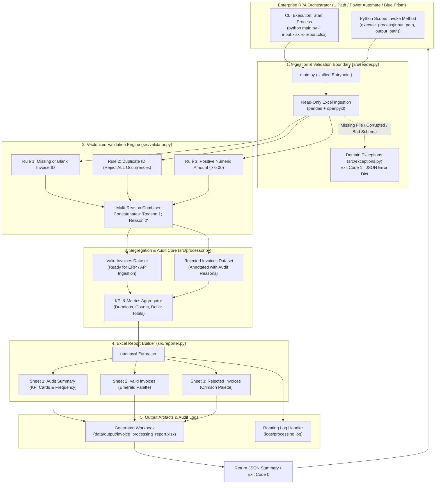

# InvoiceProcessingAutomationBot 🤖📊

[](https://www.python.org/)
[](tests/)
[](#-rpa-orchestrator-integration-guide)
[](https://peps.python.org/pep-0008/)
[](README.md)
[](LICENSE)

An enterprise-grade **Robotic Process Automation (RPA)** Python engine designed to ingest, validate, audit, and segregate batch Excel invoices with zero mutation to source files. 

Engineered for seamless standalone CLI operations and native integration with enterprise RPA orchestrators such as **UiPath** (via *Start Process* or *Python Scope*), **Microsoft Power Automate**, and **Blue Prism**.

---

## 📑 Table of Contents

- [🌟 Key Highlights](#-key-highlights)
- [🏗️ System Architecture](#️-system-architecture)
- [📋 Validation Rules Engine](#-validation-rules-engine)
- [📊 Output Report Specifications](#-output-report-specifications)
- [📸 Screenshots & Visual Tour](#-screenshots--visual-tour)
- [📁 Project Structure](#-project-structure)
- [⚙️ Prerequisites & Installation](#️-prerequisites--installation)
- [🚀 Execution Modes](#-execution-modes)
  - [1. CLI Mode](#1-cli-mode)
  - [2. Python API Mode (UiPath Python Scope)](#2-python-api-mode-uipath-python-scope)
  - [3. Local REST API Mode (FastAPI & UiPath HTTP Request)](#3-local-rest-api-mode-fastapi--uipath-http-request)
  - [4. Sample Data Generator](#4-sample-data-generator)
- [🧪 Automated Test Suite](#-automated-test-suite)
- [🤖 RPA Orchestrator Integration Guide](#-rpa-orchestrator-integration-guide)
  - [UiPath Studio (HTTP Request - Recommended for macOS)](#uipath-studio-http-request---recommended-for-macos)
  - [UiPath Studio (Start Process / Python Scope)](#uipath-studio-start-process--python-scope)
  - [Power Automate Desktop](#power-automate-desktop)
- [📜 Logging & Audit Trail](#-logging--audit-trail)
- [🛡️ Security & Read-Only Ingestion Guarantee](#️-security--read-only-ingestion-guarantee)
- [📄 License](#-license)

---

## 🌟 Key Highlights

1. **Strictly Read-Only Ingestion**: Operates using read-only workbook streaming and checks cryptographic hashes before and after reads, guaranteeing zero data mutations to input files.
2. **Aggressive Duplicate Prevention**: Flags and rejects **every single occurrence** of duplicate Invoice IDs across the batch (`keep=False`), ensuring fraudulent or mistakenly repeated invoices never reach downstream ERP systems.
3. **Multi-Reason Defect Capture**: Rather than failing on the first syntax error, the engine aggregates **all** applicable rejection reasons per record (e.g., both duplicate ID and negative amount).
4. **Executive 3-Sheet Excel Workbook**:
   - **`Audit Summary`**: Formatted KPI dashboard with run metadata, status badges, and error frequency breakdown.
   - **`Valid Invoices`**: Clean, ERP-ready records styled with emerald accents and standard currency formatting.
   - **`Rejected Invoices`**: Problem records highlighted with crimson accents and an explicit `Rejection Reasons` audit column.
5. **Fail-Fast Error Handling**: Employs domain-specific exception hierarchies for missing input files, corrupted archives, missing headers, or empty sheets.
6. **Cross-Platform Native**: Tested on Apple Silicon (macOS ARM64), Ubuntu Linux, and Windows 10/11 x64.

---

## 🏗️ System Architecture



---

## 📋 Validation Rules Engine

Each incoming invoice row is verified against the following business rules:

| Rule | Criteria / Condition | Rejection Reason | Handling Behavior |
| :--- | :--- | :--- | :--- |
| **Missing ID** | Null, `NaN`, empty string `""`, or whitespace-only | `"Missing or empty Invoice ID"` | Flagged; excluded from duplicate detection mask to avoid false matches. |
| **Duplicate ID** | Duplicate occurrence across the batch (`keep=False`) | `"Duplicate Invoice ID (all occurrences rejected)"` | **All** instances (original and replicas) are rejected for compliance audit. |
| **Invalid Amount** | Non-numeric, negative balance, or `$0.00` | `"Amount must be a positive numeric value (> 0)"` | Parsed safely; coerce failures and amounts `<= 0` are rejected. |
| **Multi-Error** | Satisfies 2 or more rejection conditions | *Combined with semicolon delimiter* | e.g. `"Duplicate Invoice ID (...); Amount must be a positive..."` |

---

## 📊 Output Report Specifications

The generated Excel workbook contains three professionally formatted worksheets:

```text
invoice_processing_report.xlsx
├── 📄 [Audit Summary]     -> Executive dashboard, KPI stat cards, and error frequency table
├── 📄 [Valid Invoices]    -> Clean, approved records styled in emerald green (ERP-ready)
└── 📄 [Rejected Invoices] -> Flagged records styled in crimson with itemized Rejection Reasons
```

### 1. `Audit Summary` Worksheet
- **Header Banner**: High-contrast navy banner with run timestamp.
- **Execution Metadata Table**: Execution Status (`SUCCESS` / `PARTIAL_SUCCESS` / `FAILED`), start/end timestamps, elapsed execution duration (seconds), and input/output file paths.
- **KPI Summary Cards**:
  - Total Records Processed
  - Valid Invoices Count & Total Valid Dollar Value
  - Rejected Invoices Count & Total Rejected Dollar Value
- **Error Frequency Breakdown Table**: Frequency table mapping each unique rejection reason to its incident count and percentage distribution.

### 2. `Valid Invoices` Worksheet
- Styled with dark green headers (`#1E4620`), white bold text, and alternating light green borders.
- Currency column formatted explicitly with accounting notation (`$#,##0.00`).
- Ready for immediate database bulk insert or robotic ingestion into ERP systems (e.g., SAP, Oracle, NetSuite).

### 3. `Rejected Invoices` Worksheet
- Styled with dark crimson headers (`#5C1D24`) and light red data grid lines.
- Includes all original input columns plus an extra **`Rejection Reasons`** column clearly identifying every violated rule.

---

## 📸 Screenshots & Visual Tour

To provide visual previews of the generated reports and execution runs, screenshots are stored in the [`assets/screenshots/`](assets/screenshots/) directory.

### Visual Preview Placeholders

#### 1. Executive Audit Summary Dashboard
> Displays the high-level KPI cards, execution status, and breakdown table.
>
> *(Place screenshot at `assets/screenshots/audit_summary.png`)*

```text
+----------------------------------------------------------------------------------------------------+
|                                  INVOICE AUDIT PROCESSING SUMMARY                                  |
|                             Generated: 2026-11-03 13:11:42 UTC | System: RPA-Bot                   |
+----------------------------------------------------------------------------------------------------+
|  TOTAL PROCESSED: 18   |   VALID: 5 ($14,055.75)   |   REJECTED: 13 ($14,600.00)   | STATUS: PASS   |
+----------------------------------------------------------------------------------------------------+
```

#### 2. Valid Invoices Sheet (ERP-Ready)
> Clean dataset with emerald headers and accounting currency formatting.
>
> *(Place screenshot at `assets/screenshots/valid_invoices.png`)*

#### 3. Rejected Invoices Sheet (Defect Annotation)
> Records flagged with specific error explanations.
>
> *(Place screenshot at `assets/screenshots/rejected_invoices.png`)*

#### 4. Terminal & CLI Execution
> CLI output displaying structured execution logs and JSON summary output.
>
> *(Place screenshot at `assets/screenshots/cli_execution.png`)*

### 📷 Instructions for Adding Screenshots

If you customize this bot and want to refresh the documentation screenshots:

1. **Run the processor** to generate the latest report:
   ```bash
   python main.py
   ```
2. Open `data/output/invoice_processing_report.xlsx` in Excel, Numbers, or LibreOffice.
3. Take high-resolution screenshots of:
   - **Sheet 1**: `Audit Summary` -> Save as `assets/screenshots/audit_summary.png`
   - **Sheet 2**: `Valid Invoices` -> Save as `assets/screenshots/valid_invoices.png`
   - **Sheet 3**: `Rejected Invoices` -> Save as `assets/screenshots/rejected_invoices.png`
4. Take a terminal screenshot of the CLI execution -> Save as `assets/screenshots/cli_execution.png`.
5. Link them in this section using standard GitHub markdown:
   ```markdown
   
   
   
   
   ```

---

## 📁 Project Structure

```text
invoice-rpa-project/
├── .gitignore                             # Comprehensive Git exclusion rules
├── LICENSE                                # MIT open-source license
├── README.md                              # Complete architecture, setup, and usage guide
├── api.py                                 # Local FastAPI REST server (127.0.0.1) for UiPath HTTP Request
├── main.py                                # Dual CLI and UiPath Python Scope entrypoint
├── requirements.txt                       # Production dependencies (pandas, openpyxl, fastapi, uvicorn, pytest)
│
├── assets/
│   └── screenshots/                       # Visual assets and documentation screenshots
│       └── .gitkeep
│
├── data/
│   ├── input/
│   │   └── sample_invoices.xlsx           # Sample input workbook with realistic test records
│   └── output/
│       ├── .gitkeep                       # Preserves output folder in version control
│       └── sample_output_report.xlsx      # Pre-generated sample multi-sheet Excel report
│
├── logs/
│   ├── .gitkeep                           # Preserves log directory in version control
│   └── processing.log                     # Application execution and rotating audit logs
│
├── scripts/
│   └── generate_sample_data.py            # Utility to generate fresh synthetic test batches
│
├── src/
│   ├── __init__.py                        # Package marker
│   ├── config.py                          # Schema constants, file paths, and status codes
│   ├── exceptions.py                      # Custom exception taxonomy (Fail-Fast design)
│   ├── logger.py                          # Dual-destination logging (console + rotating file)
│   ├── reader.py                          # Read-only Excel ingestion with schema verification
│   ├── validator.py                       # Multi-rule validation engine with reason capture
│   ├── processor.py                       # Data segregation and audit metrics aggregator
│   └── reporter.py                        # OpenPyXL multi-sheet report generator and styler
│
└── tests/
    ├── __init__.py                        # Package marker
    ├── conftest.py                        # Pytest fixtures and mock dataset factories
    ├── test_api.py                        # FastAPI REST endpoint (/process & /health) tests
    ├── test_reader.py                     # Ingestion tests (corrupt, empty, missing, schema)
    ├── test_validator.py                  # Rule tests (missing IDs, duplicate all, invalid amounts)
    └── test_processor.py                  # Integration and Excel report generation tests
```

---

## ⚙️ Prerequisites & Installation

### Requirements
- **Python**: `3.10`, `3.11`, `3.12`, or `3.13`
- **Operating System**: macOS (Apple Silicon or Intel), Linux, or Windows 10/11 / Windows Server

### Step 1: Clone or Navigate to the Workspace
```bash
git clone https://github.com/your-username/InvoiceProcessingAutomationBot.git
cd InvoiceProcessingAutomationBot
```

### Step 2: Set Up Virtual Environment
- **macOS / Linux**:
  ```bash
  python3 -m venv .venv
  source .venv/bin/activate
  ```
- **Windows (Command Prompt / PowerShell)**:
  ```powershell
  python -m venv .venv
  .venv\Scripts\Activate.ps1
  ```

### Step 3: Install Dependencies
```bash
pip install --upgrade pip
pip install -r requirements.txt
```

---

## 🚀 Execution Modes

### 1. CLI Mode

Run with default bundled sample invoices:
```bash
python main.py
```

Run with custom input, output, and log paths:
```bash
python main.py --input "data/input/sample_invoices.xlsx" \
               --output "data/output/my_custom_report.xlsx" \
               --log "logs/custom_execution.log"
```

Short flags are also supported:
```bash
python main.py -i "data/input/sample_invoices.xlsx" -o "data/output/report.xlsx"
```

#### Exit Codes for Orchestrators
- `0`: Completed successfully (or partial success with rejected records cleanly partitioned).
- `1`: Fatal error (file missing, schema violation, corrupted workbook).

---

### 2. Python API Mode (UiPath Python Scope)

For robotic automation environments running Python scripts directly in-memory:

```python
from main import execute_process

# Call the synchronous execution entrypoint
result = execute_process(
    input_path="data/input/sample_invoices.xlsx",
    output_path="data/output/invoice_processing_report.xlsx"
)

# Returns a serializable JSON/Dictionary:
print(result)
```

**Returned JSON Payload:**
```json
{
  "success": true,
  "execution_status": "PARTIAL_SUCCESS",
  "start_time": "2026-11-03 13:11:42 UTC",
  "end_time": "2026-11-03 13:11:42 UTC",
  "duration_seconds": 0.022,
  "total_records": 18,
  "valid_count": 5,
  "valid_total_amount": 14055.75,
  "rejected_count": 13,
  "rejected_total_amount": 14600.0,
  "rejection_breakdown": {
    "Duplicate Invoice ID (all occurrences rejected)": 7,
    "Missing or empty Invoice ID": 3,
    "Amount must be a positive numeric value (> 0)": 5
  },
  "generated_report_path": "data/output/invoice_processing_report.xlsx"
}
```

---

### 3. Local REST API Mode (FastAPI & UiPath HTTP Request)

For native cross-platform orchestration (especially on **macOS** where UiPath Studio interacts seamlessly over HTTP):

#### Start the Local API Server
The server binds exclusively to `127.0.0.1` for local, secure access:
```bash
python api.py
```
Or directly with Uvicorn:
```bash
uvicorn api:app --host 127.0.0.1 --port 8000
```

Once running:
- **Interactive OpenAPI / Swagger UI**: [http://127.0.0.1:8000/docs](http://127.0.0.1:8000/docs)
- **Interactive ReDoc Documentation**: [http://127.0.0.1:8000/redoc](http://127.0.0.1:8000/redoc)

#### Testing the API with `curl`

##### 1. Health Check
```bash
curl http://127.0.0.1:8000/health
```
**Response (200 OK):**
```json
{
  "status": "healthy",
  "service": "InvoiceProcessingAutomationBot"
}
```

##### 2. Process Batch (Default Sample Invoices)
```bash
curl -X POST http://127.0.0.1:8000/process \
     -H "Content-Type: application/json" \
     -d '{}'
```

##### 3. Process Batch (Custom Input & Output Paths)
```bash
curl -X POST http://127.0.0.1:8000/process \
     -H "Content-Type: application/json" \
     -d '{
       "input_path": "data/input/sample_invoices.xlsx",
       "output_path": "data/output/invoice_processing_report.xlsx"
     }'
```

**Successful Response (200 OK):**
```json
{
  "success": true,
  "execution_status": "PARTIAL_SUCCESS",
  "start_time": "2026-11-03 13:11:42 UTC",
  "end_time": "2026-11-03 13:11:42 UTC",
  "duration_seconds": 0.022,
  "total_records": 18,
  "valid_count": 5,
  "valid_total_amount": 14055.75,
  "rejected_count": 13,
  "rejected_total_amount": 14600.0,
  "rejection_breakdown": {
    "Duplicate Invoice ID (all occurrences rejected)": 7,
    "Missing or empty Invoice ID": 3,
    "Amount must be a positive numeric value (> 0)": 5
  },
  "output_file_path": "/Users/.../data/output/invoice_processing_report.xlsx",
  "input_file": "/Users/.../data/input/sample_invoices.xlsx"
}
```

##### 4. Error Responses
If the file is not found (`404 Not Found`):
```json
{
  "success": false,
  "execution_status": "FAILED",
  "error_type": "InputFileNotFoundError",
  "error_message": "Input file not found at path: /path/to/missing.xlsx",
  "input_file": "/path/to/missing.xlsx",
  "duration_seconds": 0.001
}
```
If the file is corrupted or columns are missing (`400 Bad Request`):
```json
{
  "success": false,
  "execution_status": "FAILED",
  "error_type": "MissingColumnError",
  "error_message": "Input file is missing required column(s): Amount",
  "input_file": "/path/to/bad.xlsx",
  "duration_seconds": 0.002
}
```

---

### 4. Sample Data Generator

To generate a new batch of synthetic test invoices containing various defect permutations:
```bash
python scripts/generate_sample_data.py
```

---

## 🧪 Automated Test Suite

The project includes unit and integration tests covering positive flows, schema mismatches, corrupted files, and complex multi-error combinations.

Run all tests with verbose output:
```bash
pytest -v
```

Run tests with short traceback:
```bash
pytest -v --tb=short
```

### Coverage Highlights

- **`tests/test_api.py`**:
  - `test_health_check`: Validates HTTP 200 and healthy bot state on `/health`.
  - `test_process_default_payload`: Tests end-to-end processing with default request payload.
  - `test_process_custom_paths`: Tests custom input/output routing through `/process`.
  - `test_process_input_file_not_found`: Validates HTTP 404 response on missing file.
  - `test_process_corrupted_file`: Validates HTTP 400 response on damaged file.
  - `test_process_missing_column`: Validates HTTP 400 response on schema mismatch.
- **`tests/test_reader.py`**:
  - `test_read_valid_excel`: Standard ingestion and dataframe conversion.
  - `test_input_file_not_found`: `InputFileNotFoundError` verification.
  - `test_corrupted_excel_file`: Invalid zip/corrupted file detection (`CorruptedExcelError`).
  - `test_empty_workbook`: Zero-row file rejection (`EmptyWorkbookError`).
  - `test_missing_required_column`: Missing schema validation (`MissingColumnError`).
  - `test_column_header_whitespace_stripping`: Normalization of column headers.
  - `test_input_file_never_modified`: Cryptographic SHA-256 hash comparison proving input file immutability.
- **`tests/test_validator.py`**:
  - `test_valid_invoices_pass`: Correct records approved.
  - `test_missing_invoice_id_detection`: Null, whitespace, and empty strings flagged.
  - `test_duplicate_invoice_id_rejects_all_occurrences`: Verifies **both/all** duplicate entries are rejected.
  - `test_invalid_amount_validation`: Flags zero, negative numbers, and non-numeric strings.
  - `test_multi_reason_capture`: Correct concatenation of multiple errors per row.
- **`tests/test_processor.py`**:
  - `test_process_invoices_separation`: Valid and rejected record separation logic.
  - `test_process_all_valid_status`: `SUCCESS` status when 0 rejections occur.
  - `test_excel_report_generation`: Verifies openpyxl workbook creation and sheet styling.
  - `test_execute_process_end_to_end`: Integration verification of `execute_process()`.

---

## 🤖 RPA Orchestrator Integration Guide

### UiPath Studio

#### Method 1: HTTP Request Activity (Recommended for macOS & Cross-Platform)
On macOS, running local Python scripts via .NET Windows activities is not supported in UiPath Studio Web / Cross-Platform workflows. The **HTTP Request** activity communicates directly with the local FastAPI server:

1. **Start the local API daemon** (or run as background service):
   ```bash
   python api.py
   ```
2. In UiPath Studio, install the **UiPath.WebAPI.Activities** package.
3. Drag in an **HTTP Request** activity and configure:
   - **Endpoint**: `"http://127.0.0.1:8000/process"`
   - **Method**: `POST`
   - **BodyFormat**: `"application/json"`
   - **Request Body**:
     ```text
     "{""input_path"": ""/Users/username/Invoices/batch.xlsx"", ""output_path"": ""/Users/username/Reports/report.xlsx""}"
     ```
   - **Response Content**: Create string variable `responseString`.
   - **Status Code**: Create int variable `statusCode`.
4. Add a **Deserialize JSON** activity targeting `responseString` to extract:
   - `resultObj("valid_count").ToString`
   - `resultObj("rejected_count").ToString`
   - `resultObj("output_file_path").ToString`
5. Branch workflow based on `statusCode` (e.g. `200` = success, `400`/`404` = throw RPA business/system exception).

---

#### Method 2: Start Process Activity (CLI)
1. Add a **Start Process** activity.
2. Set properties:
   - **FileName**: Path to your Python executable (e.g. `C:\RPA\InvoiceBot\.venv\Scripts\python.exe` or `python`).
   - **Arguments**: `"main.py --input ""C:\Data\Invoices.xlsx"" --output ""C:\Data\Report.xlsx"""`
   - **WorkingDirectory**: `"C:\RPA\InvoiceBot"`
3. Check the process exit code (`0` = Success / Partial Success, `1` = Failure).

#### Method 3: Python Scope Activity (Direct In-Memory Invocation)
1. Drag in a **Python Scope** activity pointing to your Python installation folder.
2. Inside the scope:
   - Use **Load Python Script** targeting `main.py`.
   - Use **Invoke Python Method**:
     - **Name**: `"execute_process"`
     - **Parameters**: `{"C:\Invoices\Batch_2026.xlsx", "C:\Reports\Audit_Report.xlsx"}`
   - Use **Get Python Object** to extract the return dictionary into a .NET object for downstream branching.

---

### Power Automate Desktop

1. Add a **Run DOS Command** or **Run Python Script** action.
2. In the command box, execute:
   ```cmd
   python.exe "C:\Path\To\InvoiceProcessingAutomationBot\main.py" -i "%InputFilePath%" -o "%OutputFilePath%"
   ```
3. Evaluate the command's standard output and `%ExitCode%`.

---

## 📜 Logging & Audit Trail

All system executions are logged simultaneously to standard output and a rotating file log at [`logs/processing.log`](logs/processing.log).

- Configured with a `5 MB` maximum file size and a backup history of 5 rolling files.
- Thread-safe formatting with timestamps, log levels, and contextual execution tags.

Sample log output:
```text
[2026-11-03 18:41:42] [INFO] [InvoiceProcessingBot]: ============================================================
[2026-11-03 18:41:42] [INFO] [InvoiceProcessingBot]: InvoiceProcessingAutomationBot execution started
[2026-11-03 18:41:42] [INFO] [InvoiceProcessingBot]: Input File:  .../data/input/sample_invoices.xlsx
[2026-11-03 18:41:42] [INFO] [InvoiceProcessingBot]: Output File: .../data/output/invoice_processing_report.xlsx
[2026-11-03 18:41:42] [INFO] [InvoiceProcessingBot]: Reading Excel file: sample_invoices.xlsx (read-only mode)
[2026-11-03 18:41:42] [INFO] [InvoiceProcessingBot]: Successfully read 18 records from sample_invoices.xlsx
[2026-11-03 18:41:42] [INFO] [InvoiceProcessingBot]: Validation completed: 5 valid records, 13 rejected records
[2026-11-03 18:41:42] [INFO] [InvoiceProcessingBot]: Processing completed in 0.022s. Status: PARTIAL_SUCCESS. Valid: 5 ($14,055.75), Rejected: 13 ($14,600.00)
[2026-11-03 18:41:42] [INFO] [InvoiceProcessingBot]: Successfully saved processing report to invoice_processing_report.xlsx
[2026-11-03 18:41:42] [INFO] [InvoiceProcessingBot]: Job completed successfully.
```

---

## 🛡️ Security & Read-Only Ingestion Guarantee

- **Source Immutability**: Uses read-only mode (`openpyxl.load_workbook(..., read_only=True)`) preventing file-lock contention and unauthorized modifications.
- **Safe Type Coercion**: Does not use Python `eval()` or dangerous deserialization routines.
- **Isolated Output**: Processed outputs are written strictly to user-designated destinations with no modifications to source paths.

---

## 📄 License

This project is licensed under the [MIT License](LICENSE). You are free to use, modify, and distribute this software for personal and commercial RPA automations.
